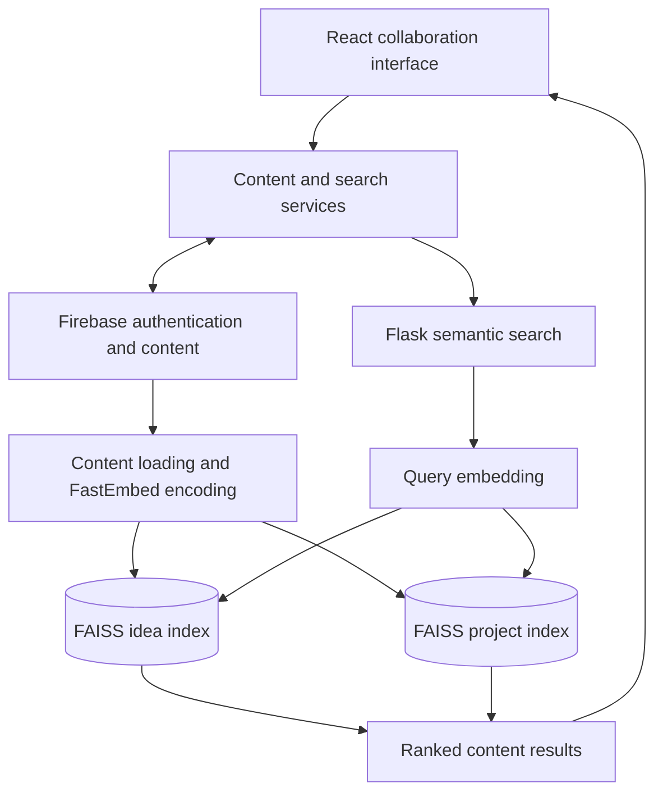

# Adyes

Adyes is a collaboration application with semantic discovery over ideas and projects.

Keyword matching is often too narrow for early-stage project discovery: people describe similar ideas in different terms. Adyes combines the React collaboration experience with a Python search service that embeds content locally and searches dedicated idea and project indexes.

[Quick start](#quick-start) · [Architecture](#architecture-and-request-flow) · [Development](#development) · [Contributing](CONTRIBUTING.md)

## Capabilities

| Workflow | Result |
|---|---|
| Publish content | Use Firebase-backed collaboration and content services. |
| Discover related work | Search ideas and projects using local FastEmbed vectors. |
| Inspect matches | Return ranked results from the appropriate FAISS index. |

## Quick start

Use the Node.js version required by the checked-in Vite dependency. The search service needs Python, its own requirements and Firebase administrative access. Embedding model setup requires an initial download.

From a fresh checkout:

```bash
git clone https://github.com/ryash14/adyes.git
cd adyes
npm install
npm run build
# Start the frontend for local development:
npm run dev
# In a second terminal with a Python virtual environment:
# pip install -r "semantic search/requirements.txt"
# npm run search
```

Configure Firebase for the client and server, including `FIREBASE_ADMIN_CREDENTIALS` or a private local credential file for the search service. The search service can enter a demo mode when Firebase is unavailable. Embedding weights download on first setup. Build output alone does not deploy Firebase or the Flask service; configure the search URL in the client service.

## Architecture and request flow

1. Users create or browse content through the React interface and Firebase-backed services.
2. The search service loads content, generates FastEmbed vectors and maintains FAISS indexes.
3. Search requests are embedded with the same encoder and matched against the appropriate content index.
4. The client presents the ranked projects or ideas.

### Component model



### Engineering decisions

The browser, Firebase services and Flask search process are separate deployment units. Client services isolate authentication, content, messages and discovery. The search service uses ONNX-backed FastEmbed and persisted FAISS artifacts.

The service can fall back to demo behavior when Firebase credentials are unavailable. That path is useful for exploration but must not be confused with a live project index.

## Implementation

**Stack:** React · Vite · Firebase · Flask · FastEmbed · FAISS · NumPy.

- [semantic search/app.py](semantic%20search/app.py)
- [src/services/semanticSearch.js](src/services/semanticSearch.js)
- [src/services/content.service.js](src/services/content.service.js)

## Development

Run the repository checks after completing setup:

```bash
npm run lint
```

Use the offline checks during development. Run provider-backed integration checks separately with configured credentials and representative inputs.

## Contributing and support

Report reproducible bugs or propose changes through [GitHub Issues](https://github.com/ryash14/adyes/issues). Include the relevant environment and a small example rather than private datasets or credentials. See [contributing](CONTRIBUTING.md), [security reporting](SECURITY.md) and the [code of conduct](CODE_OF_CONDUCT.md).

## License

No repository-wide license is currently provided. Third-party components, models and datasets retain their own terms.
