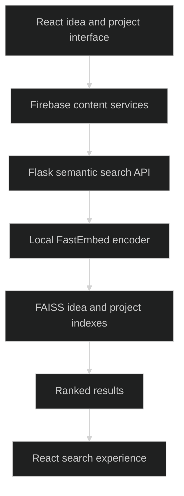

# Adyes

> `A collaboration application with local embedding search over ideas and projects.`

### 🏗️ System Architecture



### 🛠️ Production Stack

React · Vite · Firebase · Flask · FastEmbed · FAISS · NumPy

### ⚡ Key Engineering Capabilities

- Separate idea and project indexes support semantic discovery.
- FastEmbed generates local embeddings for FAISS search.
- Firebase services separate authentication, content, messaging and search concerns.

### 🚀 Deployment and Local Setup

Run from the repository root after cloning:

```bash
git clone https://github.com/ryash14/adyes.git
cd adyes
npm install
npm run build
# Start the frontend for local development:
npm run dev
# In a second terminal with a Python virtual environment:
# pip install -r "semantic search/requirements.txt"
# npm run search
```

Configure Firebase for the client and server, including `FIREBASE_ADMIN_CREDENTIALS` or a private local credential file for the search service. The search service can enter a demo mode when Firebase is unavailable. Embedding weights download on first setup. Build output alone does not deploy Firebase or the Flask service; configure the search URL in the client service.

### Verification

```bash
npm run lint
```

These commands are provided by the source configuration; this documentation update does not claim a fresh end-to-end application run.

### Source Map

- [semantic search/app.py](semantic%20search/app.py)
- [src/services/semanticSearch.js](src/services/semanticSearch.js)
- [src/services/content.service.js](src/services/content.service.js)
